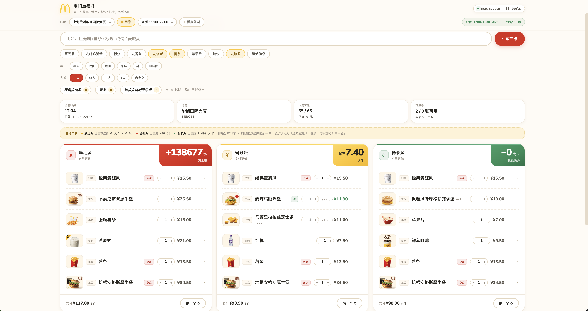

# 麦门点餐派 · Mcd-3

同一份菜单，算出三派答案：**满足派 / 省钱派 / 低卡派**，各说各的。

基于麦当劳真实门店数据（上海黄浦华旭国际大厦 1450713），在可选池子里按不同目标给你配出三卡套餐。

## 功能

- 🎯 **三派推荐**：同一组必点项，分别按满足感、最低实付、最低热量各出一卡
- 🏪 **门店切换**：支持不同门店，价格和可售商品实时变化
- ⏰ **时段切换**：早餐 / 正餐 / 夜宵，商品池自动切换
- 🎟️ **优惠券**：自动应用可用优惠券，券后价直接参与省钱计算
- 🚫 **忌口筛选**：牛肉 / 鸡肉 / 猪肉 / 海鲜 / 辣 / 咖啡因，一键排除
- 👥 **人数切换**：一人 / 双人 / 三人 / 四人 / 自定义，自动按比例配餐
- 🎲 **换一个**：不满意就换，同级别的另一种搭配

## 截图



## 在线体验

部署在 GitHub Pages 上：

👉 **https://ellioben.github.io/Mcd-3/**

## 数据来源

所有商品数据从麦当劳 MCP 接口真实抓取，非虚构。详见 [`data/README.md`](data/README.md)。

| 指标 | 数量 |
|---|---|
| 商品总数 | 125 |
| 进推荐池 | 65（主品 18 / 小食 16 / 饮料 22 / 加餐 9） |
| 带裸省（无条件优惠） | 42 |
| 带条件省（需买卡） | 19 |

## 本地运行

纯静态页面，直接打开 `index.html` 就行，或者起个本地服务：

```bash
python3 -m http.server 8000
# 然后访问 http://localhost:8000
```

## 项目结构

```
Mcd-3/
├── index.html          # 主页面（recommend.html）
├── screenshot.png      # 截图
├── assets/
│   └── mcd-arches.svg  # 麦当劳拱门 logo
└── data/
    ├── catalog.js      # 商品目录（页面直接引用）
    ├── catalog.json    # 商品目录（JSON 格式）
    └── img/            # 商品图片（126 张）
```

## 算法说明

三派各比各的极端单，不是共用同一个基线：

| 派 | 主指标 | 参照单 |
|---|---|---|
| 满足派 | 满足感 +x% | 最不扛饿的那一单 |
| 省钱派 | 少花 ¥x | 最贵的那一单 |
| 低卡派 | 少 x 大卡 | 最热的那一单 |

三个参照单都由当前门店 + 时段的可售商品按槽位取极值拼成，必点项相同 —— 是真实能点出来的组合，不是虚构基线。
